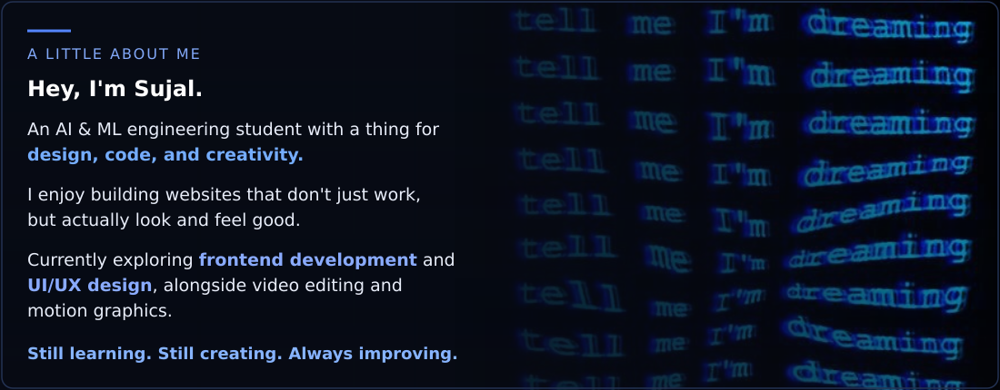

# Hi, I'm Sujal

&nbsp;
 
&nbsp;

 

Somewhere between pixels and code, turning ideas into digital experiences worth exploring.

---

## ✦ About Me

---

## ✦ Connect

&nbsp;&nbsp;&nbsp;

&nbsp;&nbsp;&nbsp;

---

## ✦ Coding Profiles

---

## ✦ Tech Stack

### Development

### Design & Creativity

---

## ✦ GitHub Stats

---

## ✦ Activity Graph

---

## ✦ Pac-Man Commit Activity

<picture>
  <source media="(prefers-color-scheme: dark)" srcset="https://raw.githubusercontent.com/sujalnaik20/sujalnaik20/output/pacman-contribution-graph-dark.svg" />
  <source media="(prefers-color-scheme: light)" srcset="https://raw.githubusercontent.com/sujalnaik20/sujalnaik20/output/pacman-contribution-graph.svg" />
  
</picture>

---

## ✦ Featured Project

### StudySnap AI

**Snap it. Understand it. Revise it.**

AI-powered study assistant that analyzes notes and textbook images, explains concepts, and helps with revision.

---

 

### "Code. Build. Improve. Repeat."

