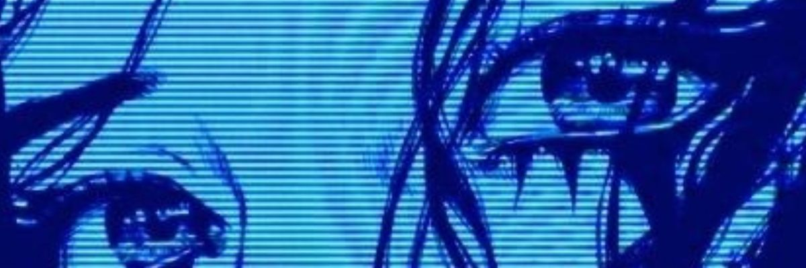
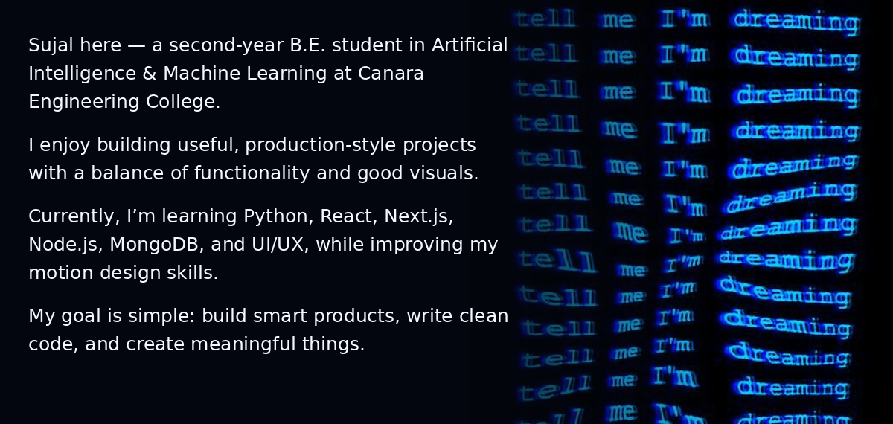

# Hi 👋, I'm Sujal

### AI/ML Developer

`Just Build Cool Stuff`

Building practical AI tools, clean web apps, and polished digital experiences.

---

## 🚀 About Me

---

## 🤝 Connect

&nbsp;&nbsp;&nbsp;

---

## 💻 Tech Stack

  

---

## 📊 GitHub Stats

---

## 📈 Activity Graph

---

## 👾 Pac-Man Commit Activity

<picture>
  <source media="(prefers-color-scheme: dark)" srcset="https://raw.githubusercontent.com/sujalnaik20/sujalnaik20/output/pacman-contribution-graph-dark.svg" />
  <source media="(prefers-color-scheme: light)" srcset="https://raw.githubusercontent.com/sujalnaik20/sujalnaik20/output/pacman-contribution-graph.svg" />
  
</picture>

---

## ✨ Featured Project

### StudySnap AI

**Snap it. Understand it. Revise it.**

AI-powered study assistant that analyzes notes and textbook images, explains concepts, and helps with revision.

---

 

### "Code. Build. Improve. Repeat."

